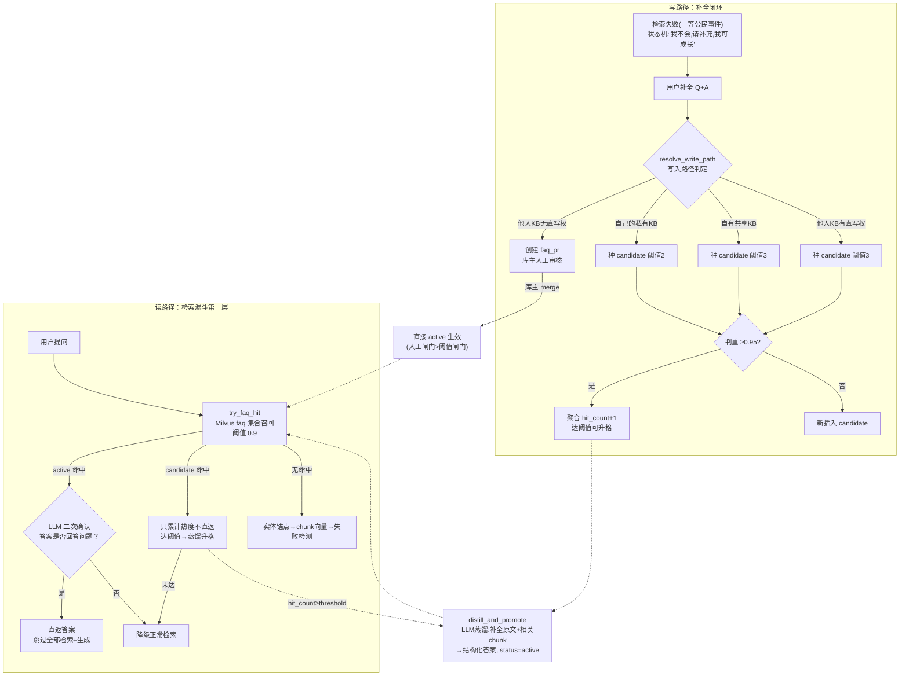

## Q1 · 第1轮 · 初始

3.自进化 FAQ 闭环：命中阈值自动distill_and_promote升格 + LLM二次确认；GitHub 式fork/PR双路径写入，私有库/共享库差异化升格门槛（累计命中2/3次），无直写权用户强制PR库主审核，防低质答案污染

这个是我简历里面写的第三条内容，我希望获取所有相关内容，类似于star法则吧，什么场景？之前怎么做的？出了什么问题？怎么看出来的问题？出现问题怎么排查的？排查之后怎么修复的？修复后有什么对比效果？等等，你可以自己扩展选择，尽可能丰富。可以画图什么的呈现方式可以多样，一切以我理解记忆为主。

## A1 · 第1轮

# 简历第三条 · 自进化 FAQ 闭环 · 全量深挖

## §0 三句话主干（必背，面试开口就说这三句）

1. **系统**：给企业知识库 RAG 加了“记忆闭环”——检索失败不再静默幻觉，而是升级为一等公民事件，引导用户补全；补全先种 candidate（记录便宜，每次都做），累计命中达阈值才 LLM 蒸馏升格 active 直返（蒸馏谨慎，达标才做），下次同问**亚秒级直返、零检索零生成**。设计哲学继承个人知识管理系统的元范式：**写库是受控函数调用 + 逻辑信号触发，不是模型自觉**。
2. **防污染四闸门**：升格门槛跟“污染面”（KB 可见范围）走——私有库累计命中 2 次（错了只坑自己）、共享库 3 次（错了全员遭殃）、**无直写权用户根本不走阈值，强制 PR 由库主人工审核**；再加直返前的 LLM 二次确认（相似度 0.9 严阈值 + “是/否”短判断，宁漏勿错）。
3. **验证**：双人协作 E2E 实测（B 无直写权补全 → 走 PR → 库主 merge → 同问命中直返，相似度 1.00）+ Stage 4 压测 50 轮成功率 90%（created 20 / merged 14 / promoted 6）+ **审计对账零缺口**（每个 action 与 `faq.*` 审计事件一一对应）——其中对账本身还踩过“假对账”坑（列名写错 + db 层吞错返回空），修正后重做才真实通过，教训是**对账工具自己也要被验证**。

---

## §1 全景知识地图（一张图知道你有什么牌）

```
                ┌──────────────────────────────────────────────┐
                │        简历第三条：自进化 FAQ 闭环              │
                └──────────────────────────────────────────────┘
                                  │
     ┌────────────────────────────┼─────────────────────────────┐
     ▼                            ▼                             ▼
【创造物：闭环本体】         【治理：防污染设计】           【验证：数据与对账】
 A 双路径闭环(读+写)         E 阈值跟污染面走(2/3/PR)       I E2E 双人协作实测
 B 状态机(candidate→active)  F LLM 二次确认(0.9+是/否)      J 压测 50 轮 90%
 C 蒸馏 distill_and_promote  G 判重聚合(≥0.95 累加)         K 审计对账零缺口
 D fork/PR 双路径写入        H 热度半衰期(7天惰性更新)      L 假对账修正案例
     │                            │                             │
     └────────────────────────────┼─────────────────────────────┘
                                  ▼
              底层哲学：事件驱动记忆（个人知识管理系统元范式迁移）
              写库=函数调用+逻辑信号，≠模型自觉；记录便宜，蒸馏谨慎
                                  ▼
              关联串线：Stage1 审计中心(埋点基建) → Stage3 本体 →
              Stage4 压测+对账 → Stage6 缓存联动(FAQ 五写路径 bump 版本)
```

---

## §2 时间线（创造 → 验证 → 数据 → 迭代，一条线背下来）

```
8-18         8-19            8-20                8-21              8-28/29           9-01
设计文档06 → 三轮评审整版重写 → 一次性实现交付 → 补齐验收+基线压测 → 复验+对账修正 → 缓存联动+埋点补全
会话研讨     删scope字段       2370509 FAQ+fork/PR  24474aa FAQ升格/   45/50 持平       ee39eb5 FAQ五写路径
GraphRAG-lite 阈值跟污染面走   +entity graph        PR闭环/克隆全验收  审计对账(修正     bump KB缓存版本
三方案对比   写入矩阵定案      +当天修3个bug包       50轮90%基线       列名后)零缺口     e3408a0 promote埋点
(放弃Neo4j/  (2/3/PR三级门槛)  c5f7f0b CHAT_MODEL   created 18/       created 20/      补传user_id
微软GraphRAG)                  c5fe7cc P0+P1×7     merged 14/        merged 14/       (审计视图不漏)
                               (克隆搬运/N+1/伪成功) promoted 8       promoted 6
```

**串联叙事 30 秒版**：这条线的核心是“**知识从一次性工具变成复利资产**”。8-18 做方案对比时定的调子是“不引入图数据库、复用三层存储、演进成本最低”；8-19 三轮评审把最容易翻车的两个问题定案——可见性怎么管（删 scope 字段，跟 KB 分享关系走）、写入怎么防污染（阈值跟污染面 + fork/PR）；8-20 一次性交付后当天连修三个 bug 包（其中 CHAT_MODEL 那个把“保守降级掩盖真故障”的教训讲得最透）；8-21 用双人协作补齐 PR 闭环验收 + 50 轮压测基线；8-28/29 复验时发现**基线的“对账通过”其实是假的**（列名错+吞错），修正重做才敢说零缺口；9-01 把 FAQ 的五个写路径全部接入缓存版本 bump——闭环与后续治理体系全部咬合。**每一轮验证都在挑自己上一轮的错**，这是我从这个项目学到的最重要方法论。

---

## §3 Part A：创造物解剖（每个术语展开讲透）

### A1. 闭环全景：读路径与写路径咬合



咬合点有两个信号：**「检索失败信号」**连接读→写（触发补全），**「热度达标信号」**连接写→读（candidate 升格 active 进入直返池）。读路径在 `rag_workflow.py:230-242` 集成——FAQ 命中时 `raw_results=[]`、`retrieved_count=0`，直接跳过整个检索漏斗。

### A2. FAQ 生命周期状态机

```
                    补全(直写路径,阈值2/3)
                          │ hit_count=1
                          ▼
                   ┌─────────────┐     hit_count ≥ distill_threshold     ┌────────┐
     手动promote──▶│  candidate  │────────────(LLM蒸馏改写answer)────────▶│ active │
                   └─────────────┘                                        └───┬────┘
                          ▲                    库主 merge PR(人工闸门)  ────┘ │
                          │                    ──────────────────────────────┤
                          │ demote(降级回candidate)◀────────────────────────┤
                          │                                                   │
                    delete(库主,物理删除)◀────────────────────────────────────┘
```

三态：`candidate`（命中只累计不直返）/ `active`（直返池）/ `pending_review`（PR 队列态，存在 `faq_pr` 表）。注意 PR merge 进来的直接是 active 且 `distill_threshold=1`——**人工审核 > 自动阈值**，审核过的问题不再需要热度验证，这是对“人比阈值可信”的显式编码。

### A3. 逐组件深挖（9 张模块卡）

---

**卡片 1｜`try_faq_hit`：读路径的分叉点**

**干什么**：每次提问先查 Milvus `faq` 集合（限用户可见 KB 范围），top-3 里取最高分，低于 0.9 直接放行到正常检索。

**关键分叉**（`faq_service.py:123-178`）：

```160:166:backend/services/faq_service.py
        if faq["status"] == "candidate":
            # candidate 不直返；达阈值 → 蒸馏升格
            if updated and updated["hit_count"] >= faq["distill_threshold"]:
                promoted = await self.distill_and_promote(faq["id"])
            logger.info(f"FAQ candidate 命中（id={faq['id']}，hit={updated and updated['hit_count']}），"
                        f"不直返{'，已升格' if promoted else ''}")
            return None
```

三个精细点：
- **candidate 命中也累计热度**——哪怕这次不直返，也在为升格攒证据。用户第 2 次问同一个问题时，这次命中本身就是“第 2 次被需要”的证明，触发的升格发生在**这一次**，下次才直返。语义上“热度达标的那次命中”既是证据又是扳机。
- **异常安全**：embedding 调用失败 → warning + return None，整个 FAQ 层对主链路是“纯增强”，坏了不拖垮检索（fail-open）。
- **可见范围**：`kb_ids = visible_kb_ids(user_id)`——私有 + 分享出去的 + 别人分享给我的，FAQ 检索的“读取视野”完全跟 KB 分享关系走，**没有独立的权限系统**。

**为什么这么设计**：FAQ 直返本质是“跳过一切验证直接给答案”，是全系统信任等级最高的动作，所以入口的每一层（分数阈值、状态门槛、二次确认）都在收紧。

---

**卡片 2｜`_confirm_answer`：LLM 二次确认**

```183:193:backend/services/faq_service.py
            prompt = (
                "判断下面的候选答案是否准确、完整地回答了用户问题。\n"
                f"用户问题：{query}\n候选答案：{answer}\n"
                "只回答一个字：是 或 否。"
            )
            resp = await self.chat.ainvoke(prompt)
            text = resp.content if hasattr(resp, "content") else str(resp)
            return text.strip().startswith("是")
        except Exception as e:
            logger.warning(f"FAQ 二次确认调用失败（保守不直返）: {e}")
            return False
```

**为什么要有它**：0.9 相似度拦不住“问法相似但语义不同”的边界 case（“怎么配置缓存 TTL” vs “怎么清理缓存”——向量距离近，答案不通兑）。FAQ 误命中的伤害比检索不到大得多：**答非所问且不自知**（用户以为系统确定，实际是张冠李戴）。所以宁可多花一次短判断调用（temperature=0、max_tokens=300，成本极低），也不让边界误命中漏过去。

**宁漏勿错的哲学**：`except → return False`——LLM 调用挂了就当没命中，降级正常检索。漏掉的代价是“这次慢一点、走全链路”，错过的代价是“给错误答案还显得很自信”，两者不对称。

**一个真实的教训（这个 bug 让我理解了 fail-safe 的双刃剑）**：最初版本把配置字段名写成了 `CHAT_MODEL`（实际是 `DEFAULT_MODEL`），二次确认**每次都抛 AttributeError → 每次都被 except 吃掉 → 每次都保守降级**。结果：用户体验完全正常（降级路径救了体验），但 FAQ 直返特性整个被隐藏了。**fail-safe 设计会掩盖真故障**——异常处理把 bug 变成了静默的性能损耗，唯一线索是日志里的 warning。修复后 `faq_hit=True, sources_count=0` 才真正工作（commit `c5f7f0b`）。这让我定了一条规则：**降级路径必须配对显式告警日志，且验收时必须断言“增强特性确实生效”而不是只断言“没报错”**。

---

**卡片 3｜`resolve_write_path`：fork/PR 路径判定（简历里“GitHub 式双路径”的本体）**

```93:120:backend/services/faq_service.py
        kb = db.get_knowledge_base(kb_id)
        if not kb:
            return {"mode": "direct", "threshold": ...}
        if kb["user_id"] == user_id:
            # 自己的 KB：是否已分享出去（共享 KB 阈值更严）
            shared = bool(db.get_kb_shares(kb_id))
            threshold = ...SHARED if shared else ...PRIVATE
            return {"mode": "direct", "threshold": threshold, ...}
        # 他人共享 KB
        if db.can_write_directly(user_id, kb_id):
            return {"mode": "direct", "threshold": ...SHARED, ...}
        return {"mode": "pr", "threshold": 0, "reason": "shared_review_required"}
```

**判定矩阵（背下来）**：

| 场景 | mode | 阈值 | 对应 GitHub |
|---|---|---|---|
| 我的私有 KB | direct | **2** | 自己的仓库随便 push |
| 我分享出去的 KB | direct | **3** | 自己的公开仓库——还是能 push，但知道有 watcher |
| 他人 KB + `can_write_directly=true` | direct | 3 | collaborator 权限，可直接 push |
| 他人 KB + 无直写权 | **pr** | 不走阈值 | **outsider 只能提 PR，owner 审核才能 merge** |
| 全局入口（kb_id=None） | 永远落默认私有 KB | 2 | 不确定该提交到哪 → 先存自己 fork |

**最精妙的一条规则（面试亮点）**：全局入口**永不直接写共享 KB**。因为全局检索同时搜了多个 KB，“这条补全该归哪个库”歧义太大——直接写共享库等于“我猜你想把它提交到团队库”，猜错就污染全员。所以全局补全一律落到 `DEFAULT_PERSONAL_KB_ID`（不存在则自动创建“我的知识库”），想贡献给共享库？显式提 PR，库主自己决定。

**为什么阈值要按“写入时快照”存进每条记录**（`distill_threshold` 字段）而不是实时查配置：①升格判断时不用回查 KB 归属（记录自带答案）；②KB 后续分享状态变了，已种下的 candidate 仍按种下时的污染面判定——**风险敞口在写入那一刻就锁定了**，这是个很干净的审计语义。

---

**卡片 4｜热度模型：半衰期 + 惰性更新**

```502:517:backend/services/database.py
            self.cursor.execute('''
                UPDATE faq
                SET hit_count = hit_count + 1,
                    heat_score = (hit_count + 1) * POWER(0.5,
                        EXTRACT(EPOCH FROM (CURRENT_TIMESTAMP - COALESCE(last_hit_time, CURRENT_TIMESTAMP)))
                        / 86400.0 / %s),
                    last_hit_time = CURRENT_TIMESTAMP,
                    updated_at = CURRENT_TIMESTAMP
                WHERE id = %s
                RETURNING hit_count, heat_score, status, distill_threshold
```

公式：`heat_score = hit_count × 0.5^(距上次命中天数 / 7)`。

**三个设计决策**：
- **为什么有衰减**：知识有时效性。半年没人问的问题不该永远占着 FAQ 的坑位（FAQ 直返池越大，误命中面越大）。冷门 = 自然冷却。
- **为什么惰性更新**（只在命中时算，无后台定时任务）：Cron 扫全表是“为了一个大多时候不看的字段持续付费”；惰性计算把成本精确摊到“真正发生命中”的时刻。零额外基础设施，简单可解释。
- **注意升格判据用的是 `hit_count`（累计次数）而非 `heat_score`（衰减热度）**——升格问的是“这个问题被需要过几次”（历史事实），不是“它现在还热不热”（当前状态）。衰减服务于排序/淘汰，不服务于升格门槛，两个指标各司其职。被问到这个区别是加分题。

---

**卡片 5｜`distill_and_promote`：蒸馏的“源”是关键**

```289:314:backend/services/faq_service.py
            context = ""
            try:
                qv = await self.embedding.aembed_query(faq["question"])
                chunks = client.query(faq["question"], limit=3,
                                      metadata_filter={"knowledge_base_id": faq["kb_id"]},
                                      retrieval_mode="native")
                ...
            prompt = (
                "你是知识蒸馏助手。把下面的用户补充内容整理为一条结构化、准确、可复用的知识问答。\n"
                ...
```

**蒸馏输入 = 用户补全原文 + 该 KB 内向量检索到的 top-3 相关 chunk（各截 500 字）**，LLM 整合成结构化答案。

**为什么不直接存补全原话**：①口语化表达复用价值低（“这个啊 你要在设置里把那个开关打开”）；②缺上下文的碎片会逐渐把 FAQ 库变成聊天记录垃圾场；③有 KB 原文参与，蒸馏时 LLM 能**核对补全与已有知识的一致性**，补全写错还能被纠出来一部分。蒸馏失败时回退原文（`distilled.strip() or faq["answer"]`），取上下文失败不致命（仅用原文蒸馏）——**增强路径永远不能阻塞主流程**。

**“记录 ≠ 蒸馏”是整个防污染设计的第一原则**：记录便宜（每次补全都做，一条 INSERT），蒸馏昂贵（LLM 调用 + 答案被固化进直返池 = 污染风险）。便宜的动作高频做，昂贵的动作要证据（热度/审核/显式触发）才做。

---

**卡片 6｜`merge_pr`：人工闸门**

```342:349:backend/services/faq_service.py
        if not db.resolve_faq_pr(pr_id, "merged", reviewer_id, note):
            return {"action": "error", "message": "PR 状态更新失败"}
        faq_id = db.add_faq(
            kb_id=pr["target_kb_id"], owner_id=reviewer_id,
            submitter_id=pr["submitted_by"], question=pr["question"],
            answer=pr["answer"], source="pr_merge", status="active",
            distill_threshold=1)  # active 不再走阈值
```

权限三重校验：PR 存在且 open → 操作者是目标 KB 的 `user_id`（库主，不是 admin 不是 submitter）→ 状态机迁移。merge 后直接 `status="active"`——**人工审核的信任等级高于自动阈值**，审核过的问题不需要再攒热度。`reject_pr` 同构，附 `review_note` 留痕。

**为什么无直写权 = 强制 PR 而不是“更高阈值”**：阈值是自动闸门，可被刷（问 3 次就过）；人工闸门不可刷。对外部贡献者，**污染的代价是库主的声誉资本**（共享库错答案，所有人 first blame 库主），所以把终审权交给承担代价的人——代价与权力对齐。

---

**卡片 7｜`clone_kb`（fork）：三个存储的搬运**

fork 一个 KB = PG 全量复制（doc/chunk/增强/FAQ + id 映射表）+ Milvus 四集合向量按映射重写 + **BM25 内存索引手动重建**。第三步是最隐蔽的坑：

```400:412:backend/services/faq_service.py
        # BM25 关键词索引：克隆的 chunk 需入内存索引（PG 有数据但
        # load_from_database 只在启动时执行，克隆后关键词检索会空）
        try:
            from services.bm25_client import get_search_client
            chunks = db.get_document_chunks_by_ids(list(result["chunk_map"].values()))
            ...
            get_search_client().bulk_index_chunks(chunks)
```

**坑的本质**：BM25 是内存索引，只在服务启动时从 PG 加载。克隆写进了 PG，但内存索引不知道——不手动 `bulk_index_chunks`，克隆库的关键词检索**静默返回空**（数据明明都在）。这是“**持久层数据源与内存索引生命周期不同步**”的典型问题，同类问题在业界叫 cache invalidation / index rebuild（ES 的 reindex、读库扩容后的索引预热）。另外整个 clone 在 API 层用 `run_in_executor` 包了一层（`api/faq.py:195-209`）——大库克隆要数十秒，同步跑会阻塞事件循环让全服务排队，这是 Stage 4 压测修 reranker 时确立的先例的直接复用（**关联第一条：线程治理的教训变成了代码评审时的肌肉记忆**）。

快照克隆**不追上游**（有意为之）：符合“补全是我个人当时的知识快照”语义；上游修错了 FAQ，下游克隆版保留旧答案反而是“我的 fork 我做主”的 GitHub 语义。

---

**卡片 8｜判重聚合：多人重复补全 → 热度自然聚合**

```238:259:backend/services/faq_service.py
        dup_hits = client.search_faq(query_vec, [kb_id], limit=1)
        if dup_hits and dup_hits[0]["score"] >= dedup_threshold:
            # 聚合到已有记忆
            faq = db.get_faq(dup_hits[0]["pg_faq_id"])
            ...
                updated = db.increment_faq_hit(faq["id"], half_life)
```

同一 KB 内新补全的问题向量与已有 FAQ 相似度 ≥0.95 → 判定同一记忆，不插入新行，`hit_count` 累加。**共享 KB 十个人各自补全同一个问题，自然聚合为一条记录 + 热度 10——热度本身就是“这问题多人遇到”的证据**，直接推着它过升格阈值。实测重复 supplement 同一问题 11 次，始终只有一条记录、hit_count 一路累加（幂等性验证）。0.95 是“几乎同句”级别的严判重，宁可不聚合也不误合并语义相近的不同问题。

---

**卡片 9｜存储模型与审计联动**

**PG 权威 + Milvus 向量**（与项目三层架构同构）：PG `faq` 表存全部业务字段（热度、状态、阈值、审核），Milvus `faq` 集合只存 question 向量 + 召回所需最小字段。召回走 Milvus，**状态判定回 PG**（“PG 为权威”）——好处是 Milvus 里的向量永不因状态变更而改写，状态机完全在一个事务库里演进。

**审计埋点族**（Stage 1 审计中心的直接受益者）：`faq.hit / faq.aggregate / faq.candidate_create / faq.promote / faq.demote / faq.delete + faq_pr.submit/merge/reject + kb.share/unshare/clone`——**每一条写路径、每一次状态迁移都有事件记录**。这不是“锦上添花的日志”，它是 Stage 4 压测“审计对账”的数据基础（见 §5），也支撑共享模式下的可信性与事后追责（谁提交的、谁审核的、何时升格的，全可查）。

---

## §4 Part B：怎么验证的（实验设计本身也是创造物）

| 实验 | 设计 | 结果 |
|---|---|---|
| **闭环 E2E** | 提问库中不存在的事实 → 走“请补充”分支 → 补全 → 同问法再问 | faq#2 hit 1→2 自动蒸馏升格（口语→结构化答案肉眼可见变化），第 2 次命中直返 `faq_hit=true`、`sources_count=0`（**零检索零生成**） |
| **种子不立即蒸馏** | 补全后立即查状态 | `status=candidate, hit_count=1 < threshold=2`——防污染第一闸门生效 |
| **判重幂等** | 同一问题重复 supplement ×11 | 始终一条记录，`action=merged`，hit_count 累加到 11 |
| **PR 双人协作** | prverify 注册新号 → tester 分享 KB 给它（无直写权）→ prverify 补全 → **验证走了 PR 而非直写** → tester merge → prverify 同问检索 | `pr_id=2`、merge 后 `faq#19 active`、**同问命中直返相似度 1.00**；audit 里 submit/merge 两条留痕完整 |
| **压测 50 轮**（Stage 4 场景 3） | 30 新增 supplement + 10 重复 supplement + 10 demote/delete 交替，wall=320s | **45/50（90%，与基线完全持平）**；created 20 / merged 14 / promoted 6 / demote 5 / delete 5；5 个失败全是脚本对已删 faq 重复 delete → 404，**服务侧零错误** |
| **审计对账** | 压测窗口内审计事件 vs 脚本记录的 action 逐类比对 | `faq.aggregate=20 / faq.candidate_create=20 / faq.promote=6 / faq.demote=5`，与行为一一对应，**零缺口** |

**实验设计的方法论**（被追问“你怎么测试的”时展开）：①先测**单链路**（每条闸门单独验证：种子不蒸馏、判重、状态机），再测**双人协作**（权限分叉是最容易错的地方，必须真实两账号），最后**并发压测 + 对账**（单次对不对 ≠ 并发下对不对）。②验证“特性生效”要断言正向信号（`faq_hit=true`、`sources=0`），不能只断言“没报错”——CHAT_MODEL bug 就是被“没报错”掩盖的。③错误要归因分类：压测 5 个失败逐个看，确认全是测试脚本自身问题，两次独立压测失败模式一致，才敢下“服务无错”的结论。

---

## §5 Part C：数据说了什么 + 数据洞察驱动迭代

**数字弹药库**（全部项目实测）：

| 数字 | 含义 | 出处 |
|---|---|---|
| 45/50（90%） | 闭环 50 轮成功率，两次独立压测持平 | stage-4-report 场景 3 |
| created 20 / merged 14 / promoted 6 | 一次压测内四类 action 的自然分布 | 同上 |
| 阈值 2 / 3 / PR | 三级升格门槛 | 三轮评审定案 |
| 0.9 + 0.95 | FAQ 命中阈值 / 判重阈值 | 设计文档 06 §7 |
| 相似度 1.00 | PR merge 后同问命中直返 | Stage 3 双人验收 |
| hit_count → 11 | 判重聚合幂等性实测 | 8-20 验证报告 |
| 半衰期 7 天 | 热度衰减参数（可配） | `FAQ_HEAT_HALF_LIFE_DAYS` |
| sources_count=0 | 直返时零检索（亚秒级的证据） | E2E 实测 |
| 320s / 50 轮 | 压测 wall time | stage-4-report |

**数据洞察驱动的三次迭代**（这是“闭环不只是功能，还接进了治理体系”的证据）：

1. **审计对账暴露“对账本身不可信”→ 修正方法**。8-28/29 复验时翻 `scenario3_audit_recon.log` 发现基线对账输出是 `{}` + TypeError：原脚本用了错误列名（`created_at`，实际是 `occurred_at`），而 db 模块捕获异常后**吞错返回空**——脚本拿到空结果，第一轮“对账”其实是假通过。修正列名重做后，四类事件与 action 逐一对上，零缺口才成立。沉淀两条规则：**对账工具遇到“零事件”应该报警而不是报成功**（空结果是异常信号，不是通过信号）；**数据层吞错是把异常静默化的反模式**（错误要向上传播成显式失败）。
2. **审计视图发现埋点缺陷 → 一行修复**。复验发现 `faq.promote` 埋点漏传 `user_id`（其他埋点都传了）——按用户过滤的审计视图会漏看升格事件，多租户系统里这等于“某个用户的操作在账本里查不到”。commit `e3408a0` 补上 `user_id=faq.get("submitter_id")`。**埋点的完整性是审计可用性的前提**，而这类缺陷只有“真用审计视图看数据”时才暴露——又一次证明观测体系自己也需要被观测。
3. **压测行为分析 → 缓存一致性联动**。FAQ 的答案是会变的（蒸馏改写 answer、demote、delete、PR merge），而 Stage 6 引入了 KB 级检索缓存——**升格/降级/删除后的旧答案可能还在缓存里被直返**，这是“FAQ 自进化”与“缓存加速”两条线交叉出的脏数据风险。commit `ee39eb5` 把 FAQ 的五个写路径（aggregate / writeback / promote / demote / delete / pr_merge）全部接入 `bump_kb_cache`，写路径一发生就 bump 缓存版本，下次检索自动失效重建。**这是“数据说了什么”的高级形态：不是某个指标异常，而是把两条独立演进的子系统放到一起审视时，交叉点上的隐患**。

---

## §6 Part D：问题全档案（储备区——被问“踩过什么坑”时的完整弹药）

> 按叙事主线规则，这些不进主干；但每条都按你要求补全“出了什么问题 → 怎么看出来 → 怎么排查 → 怎么修 → 修后效果”。

**坑 1：CHAT_MODEL → DEFAULT_MODEL（特性被静默隐藏）——最值得讲的一条**
- **出了什么问题**：FAQ 直返完全不工作，`faq_hit` 永远 false。
- **怎么看出来的**：8-20 验证报告逐项实测时，向量召回明明成功（Milvus 里查得到），二次确认却总是“不通过”。
- **怎么排查的**：顺故障链回溯——召回成功 → active 命中 → `_confirm_answer` 内 `settings.CHAT_MODEL` 抛 `AttributeError`（Settings 类属性实际叫 `DEFAULT_MODEL`，`config.py:44`）→ except 捕获 → 按设计保守 `return False` → 降级正常检索。**每一环单看都“正确”：异常处理是设计好的降级，降级路径也真的兜住了用户体验**——但串联起来，一个字段名 typo 把整个特性变成了静默 no-op。
- **修复**：两处 `CHAT_MODEL` → `DEFAULT_MODEL`（`c5f7f0b`），同时修了 GraphStrategy 里同源的引用。
- **修后效果**：`faq_hit=True`、`sources_count=0` 完全工作。
- **一句话教训**：fail-safe 降级会掩盖真故障——降级路径必须配对显式告警，且验收必须断言“特性生效的正向信号”，不能只看“没报错”。

**坑 2：SSE 透传丢标记**
- **问题**：后端明明返回了 `suggest_supplement`（“请补充”引导）和 `faq_hit`，前端永远收不到——ClawAgentAdapter 的 StreamChunk metadata 只透传 `sources_count`，其余字段全被丢掉。
- **发现**：前端联调时引导 UI 不出现，网络面板里 SSE 事件里也没这两个键 → 定位到适配器层字段白名单。
- **修复**：StreamChunk metadata 增加两个字段透传（`2370509` 系列）。
- **教训**：**流式链路上的每一跳都是字段黑洞**，跨层字段要么显式契约化（pydantic model 全量声明），要么就会在某跳悄悄蒸发。

**坑 3：隐式 PR 创建失败伪成功（P1-2）**
- **问题**：无直写权用户补全时 `create_faq_pr` 失败返回 `None`，接口照样返回成功——用户以为提交了，实际什么都没发生，“被审核”是幻觉。
- **发现**：审阅（code review）发现 `pr_id` 未判空。
- **修复**：`pr_id is None` → `logger.error` + 返回明确错误“知识条目提交失败（PR 创建失败），请稍后重试”（`faq_service.py:217-220`）。
- **教训**：**乐观路径编程**（默认一切成功）在写路径上是反模式；错误必须显式传播给用户，伪成功比报错恶劣得多。

**坑 4：PR 列表 N+1 + 假分页（P1-7）**
- **问题**：查“我名下所有 KB 收到的 PR”逐 KB 循环查询（N+1），且 `page_size=100` 截断伪装成分页。
- **修复**：改单次 `ANY` 查询，真分页（`api/faq.py:251-253`）。
- **教训**：N+1 是经典反模式，但**“看起来有分页参数”和“真的分页”是两回事**——后者要求数据库层一次拿到全集再切页。

**坑 5：克隆向量搬运 bug（审阅猜想 vs 实测真相）**
- **问题**：克隆库的 subquestions 检索异常。
- **排查过程（这个案例的价值在过程）**：审阅时先提出了一个猜想（以为是搬运逻辑遗漏）；**实测后发现真因是 subquestions 的 `chunk_id` 未查映射表重映射，恒为 0**——猜想与真相不同。按实测真相修复后验证通过。
- **教训**：审阅产生的猜想必须实测验证再修——“看起来像这个原因”和“是这个原因”之间隔着一次复现。

**坑 6：P0 级——GraphStrategy 模块级 logger 未定义**
- 模块级用了 `logger` 但没初始化，运行到 graph 路径直接 NameError。修复后验证 `graph 调用 NameError=0`。同期还手工处理了 9 处/4 文件的合并冲突（含 `rag_workflow.py` 热读被覆盖的语义冲突）。教训：**多 Stage 并行开发的合并冲突里，语义冲突（逻辑被静默覆盖）比文本冲突危险得多**。

**坑 7：压测 5 个 delete 404**
- **问题**：50 轮压测 5 个失败。
- **排查**：逐条看失败明细——全是脚本对**已删除的 faq_id 重复 delete** → 服务端正确返回 404。基线（8-21）与复验（8-28/29）失败模式完全一致。
- **结论**：不是服务 bug，是测试脚本自身的状态管理缺陷。诚实记录为“90% 成功率 + 5 个失败全为脚本侧问题”，**不美化也不混淆**。
- **教训**：压测错误率必须归因分类——“服务错误”和“工具错误”要分开报，否则要么冤枉服务，要么掩盖真问题。

---

## §7 业界对照（每个“我们的做法”配“业界怎么做”+ 为什么不同）

| 我们的做法 | 业界主流 | 差异与选择理由 |
|---|---|---|
| FAQ 直返（active 命中跳过一切） | **GPTCache 语义缓存**：query embedding 相似 → 直接返回缓存的 LLM 答案 | 同构点：都是“语义级短路”。差异：GPTCache 是**被动缓存**（缓存 LLM 自己生成过的答案，答案质量随生成质量波动）；我们是**主动知识沉淀**（失败时用户补全种子 + 热度验证 + LLM 蒸馏成结构化知识 + 多道审核）——缓存的是“被验证过的知识”而非“某次生成的输出”。且 GPTCache 单租户，我们有污染面治理 |
| candidate/active 两态 + 热度升格 | **Mem0 / Zep / Letta(MemGPT)** 记忆框架：Mem0 做 fact 抽取 + ADD/UPDATE/DELETE 冲突判定；Zep 做时间感知记忆；MemGPT 分层记忆（core/archival）+ 自主整理 | 业界解决“记什么、怎么整理”；我们的差异点是**多租户协作治理**（业界记忆框架几乎全是单 agent 单用户，没有“我的记忆污染了别人怎么办”的问题）。热度阈值升格 + fork/PR 权限治理在记忆框架里是少见的。被问“为什么不用 Mem0”答：引入框架 ≠ 解决治理，且我们的事件驱动哲学（hook/函数调用强制触发）是自研内核，框架装不进来 |
| fork/PR 双路径 + 库主审核 | **GitHub 协作模型**（outsider→fork+PR、collaborator→直推）、**GitOps 发布门禁**（staging→prod 需审批） | 直接移植了“**信任分级 = 写入路径分级**”的社会学设计：影响面越大，人工介入越深。我们额外做的：阈值也跟污染面走（GitHub 没有“commit 攒 3 次自动进 main”——我们有，因为知识条目的验证成本低，热度可代替部分人工审核） |
| 热度半衰期（7 天） | **Hacker News/Reddit 排序**（gravity 衰减）、Redis 惰性删除、缓存 TTL | 同一数学骨架：`新近度 = e^(-λΔt)`。我们用于“FAQ 坑位淘汰”，业界用于 feed 排序/内存回收——**衰减的本质都是“旧证据的证明力随时间下降”** |
| LLM 二次确认（是/否短判断） | **LLM-as-judge**（评估场景）、**NeMo Guardrails / guardrails 框架**（输出侧拦截） | 我们是**入口侧最小化 judge**：一次调用、一个字、temperature=0——追求零成本拦截边界误命中，而非全面质量评估。选“是/否”而非打分：二分类判断的 LLM 一致性远高于打分，且只需要“拦住最错的” |
| 记录 ≠ 蒸馏（种子不立即固化） | **草稿-发布分离**（draft→publish）、**staging→prod** 环境门禁 | 同构：便宜的进草稿，贵的动作过门禁。差异：我们的“门禁条件”是**使用数据本身**（热度），发布流程的门禁是人工审批——RAG 场景下高频问题人工审不过来，热度是可规模化的代理指标 |
| 审计埋点 + 对账 | **事件溯源**（Event Sourcing）、**OpenTelemetry** 可观测性、金融对账系统 | 我们是轻量版：埋点族全覆盖写路径 + 压测窗口对账。金融级做法有双录核对/断点续对；我们用“action 分布 vs 事件计数”逐类对账即可证明零缺口。假对账的教训（§5）恰好对应业界的“对账系统自身需要金丝雀验证” |

---

## §8 追问速答表

| 追问 | 30 秒答案 |
|---|---|
| 阈值为什么是 2/3？ | 本质是污染面：私有 2（快速沉淀，错了只坑自己）、共享 3（防污染，错了全员遭殃）、无直写权不走阈值走人工。数值本身可配（`FAQ_DISTILL_THRESHOLD_PRIVATE/SHARED`），设计重点是**门槛与影响面绑定**这个结构，不是具体数字 |
| 2 次就升格会不会太松？被刷怎么办？ | 私有库刷 2 次→只污染自己，风险自担，可接受；共享库刷 3 次确实可能——**诚实说：当前无反刷机制**，但 audit 全量留痕（谁、何时、什么问题），事后可审计发现异常模式。对照 Stack Overflow 早期靠 flag+声誉分级治理，未来可加 per-user 速率限制或声誉分 |
| 0.9 + LLM 确认，两次过滤是不是过度？ | 不是串联冗余，是拦截不同错误：0.9 拦“向量空间远”的（便宜，一次 Milvus 查询）；LLM 确认拦“向量近但语义不同”的边界 case（贵但精准）。成本上确认是 temperature=0、一个字的短调用，命中本身低频（高频问题早升格了），边际成本可忽略 |
| FAQ 库会不会越攒越脏？ | 四道防线：记录≠蒸馏（垃圾进不了 active）、半衰期衰减（冷门自动降权）、库主 demote/delete 手动清理、审计全量可追责。但**没有自动淘汰机制**（衰减只降 heat_score 不降 status），靠手动，诚实承认这是当前边界 |
| 蒸馏把用户答案改坏了怎么办？ | 三重兜底：蒸馏 prompt 要求“核对与 KB 上下文一致性”；蒸馏失败回退原文；库主可 demote（回 candidate）+ delete。audit 里 promote 事件存 before/after 全文对照，可审计蒸馏质量 |
| 克隆库和上游不一致？ | 有意设计（快照语义，GitHub fork 同理）。上游修了错误 FAQ，克隆版保留旧答案——符合“我的知识快照我做主”。要同步就提 PR / 重新 clone，未来可加 rebase |
| PR 堆积没人审？ | 设计在文档（队列按提交时间排序 + 超期提醒 + admin 批量处理），实现做了队列排序，自动提醒未做——诚实声明。缓解：PR 路径只在“无直写权”场景触发，量级天然有限 |
| 全局检索为什么不能写共享库？ | 目标歧义：同时搜了 N 个库，“这条补全归谁”无法自动判定；写错库 = 污染全员。规则：全局补全一律落默认私有 KB，贡献共享库是显式动作（PR），把歧义的裁决权交还库主 |
| 性能影响？ | 命中时是**加速**（跳过检索+生成，亚秒直返）；未命中多一次 Milvus faq 查询 + 一次 embedding（与正常链路的 embedding 可复用思路）。Stage 4 压测全链路 90% 成功、wall=320s/50 轮，无性能异常 |
| 为什么 FAQ 阈值 0.95 判重这么严？ | 宁可不聚合（多一条近似记录，代价小）也不错聚合（两条不同问题被并成一条，答案错配，代价大）。与命中 0.9 的不对称是一致的哲学：**判错方向的代价不对称时，阈值向安全侧偏** |

---

## §9 诚实声明清单（面试前过一遍，别被自己简历反杀）

1. 90% 压测成功率中 5 个失败是**脚本侧问题**（重复 delete 404），服务零错误——说的时候要主动澄清口径，别让面试官以为服务有 10% 错误率。
2. 无反刷热度机制（审计可事后发现，无事前拦截）。
3. 冷门 FAQ 无自动淘汰（衰减只影响 heat_score，不降 status），清理靠手动 demote/delete。
4. PR 超期自动提醒设计有、实现无。
5. 判重 0.95 阈值未做敏感性分析（经验值 + 幂等性实测，无 sweep 实验）。
6. FAQ 答案质量无自动化评估（RAGAS 评的是检索链路，蒸馏质量靠 LLM 一致性核对 + 人工 demote 兜底）。
7. 审计对账第一轮是假通过（列名错 + 吞错），修正后重做的才是真结果——主动讲这个反而是加分项（见 §5 洞察 1）。
8. 压测 FAQ 是脚本生成的测试数据，非真实用户行为分布（真实分布下 action 配比会不同，但机制验证不受影响）。

---

## §10 记忆锚 + 串联（收尾背这个）

**锚点词**：`2/3/PR`（三级门槛）· `0.9+是/否`（双过滤）· `记录便宜蒸馏谨慎` · `阈值跟污染面走` · `全局入口永不写共享库` · `PG 是账本 Milvus 是索引` · `sources_count=0`

**60 秒终极串联**（把三条简历线串成一体的版本）：

> 这个闭环的设计源头是我的个人知识管理系统——"hook 发现信号、skill 规范动作、storage 长期留存”的事件驱动记忆元范式，FAQ 闭环是它在一个多租户业务 RAG 上的实例化：检索失败检测器是 hook，`save_*` 受控函数是 skill，PG+Milvus 是 storage。落地时最核心的判断有两个：**记录和蒸馏分离**（补全先种 candidate，热度证明价值后才 LLM 蒸馏固化），**门槛跟污染面走**（私有 2、共享 3、无直写权强制 PR——信任分级 = 写入路径分级，GitHub 协作模型的社会学移植）。验证走三层递进：单闸门单测、双人 PR 协作 E2E（merge 后同问直返相似度 1.00）、50 轮压测 + 审计对账零缺口——对账还揪出了自己的“假对账”bug，让我把“对账工具也要被验证”变成了规则。最后 FAQ 的五个写路径全部接进了 KB 缓存版本 bump，闭环和性能治理、审计中心、缓存一致性三条线全部咬合成一个体系，而不是孤立功能。

---

需要的话，下一步可以：①把这份材料合成为总复习图格式的文档存到 `D:\workspace\demo\test_面试准备\resume_深挖\`（与第一条并列）；②对任意模块卡做二轮深挖（比如“和 Mem0/Zep 逐字段对比”或“热度模型若改成 RL 乐队会怎样”这类延伸追问演练）；③基于此做模拟追问对抗。
